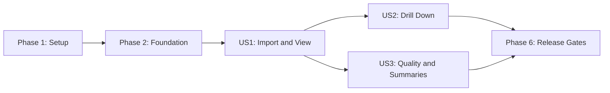

# Tasks: Interactive Heart Rate Graph

**Input**: Design documents from `specs/001-heart-rate-graph/`

**Prerequisites**: [plan.md](plan.md), [spec.md](spec.md), [research.md](research.md),
[data-model.md](data-model.md), [contracts/](contracts/), [quickstart.md](quickstart.md)

**Tests**: Tests are mandatory under the project constitution. Within each story, write the listed
tests first, confirm they fail for the expected reason, then implement the behavior.

**Organization**: Tasks are grouped by user story so each increment can be validated at its checkpoint.

## Format: `[ID] [P?] [Story] Description`

- **[P]**: Can run in parallel because it changes different files and has no dependency on another
  incomplete task in the same group.
- **[Story]**: Maps the task to a user story from the feature specification.
- Every task names the exact file or directory it changes.

## Phase 1: Setup (Shared Infrastructure)

**Purpose**: Establish the static TypeScript application and required quality commands.

- [x] T001 Initialize React 19, strict TypeScript 6, Vite 8, and exact-pinned `@streamparser/json-whatwg` dependencies plus uPlot 1.x in `package.json` and `package-lock.json`
- [x] T002 Create the application entry points and module-worker bootstrap in `index.html`, `src/main.tsx`, and `src/worker/import-worker.ts`
- [x] T003 [P] Configure strict browser and worker TypeScript projects in `tsconfig.json`, `tsconfig.app.json`, and `tsconfig.worker.json`
- [x] T004 [P] Configure formatting, linting, and the `format:check`, `lint`, and `typecheck` scripts in `.prettierrc.json`, `eslint.config.js`, and `package.json`
- [x] T005 [P] Configure Vitest 5 and React Testing Library with deterministic timezone setup in `vitest.config.ts` and `tests/setup.ts`
- [x] T006 [P] Configure Playwright 1.x projects for Chromium, Firefox, WebKit, desktop, mobile touch, and axe checks in `playwright.config.ts`

**Checkpoint**: Dependency installation, type checking, empty test suites, and a production build run successfully.

---

## Phase 2: Foundational (Blocking Prerequisites)

**Purpose**: Define shared contracts, state boundaries, fixture tools, and the accessible application shell.

**CRITICAL**: No user story implementation begins until this phase is complete.

- [x] T007 Create discriminated UI-to-worker and worker-to-UI message types from `contracts/worker-protocol.md` in `src/shared/worker-messages.ts`, enforcing “Every command includes `requestId`; dataset commands also include `datasetId`”
- [x] T008 Create shared domain types in `src/domain/readings.ts`, including Import Session constraints “`sessionId`: Unique within the page lifetime”, “`fileSizeBytes`: non-negative integer”, “`processedRecords`: Monotonically increases during import”, and “`datasetId`: Present only after successful commit”
- [x] T009 [P] Implement locale-aware instant, duration, bpm, count, and timezone-offset formatting helpers in `src/shared/format.ts`
- [x] T010 [P] Implement startup checks for workers, `Blob.stream()`, typed arrays, `BigInt`, canvas, and pointer/touch support in `src/app/browser-capabilities.ts`
- [x] T011 [P] Create synthetic Google Fit fixture builders for valid, malformed, duplicate, out-of-order, timezone, gap, and generated-volume cases in `tests/fixtures/google-fit-builder.ts`
- [x] T012 Build the reducer/context state machine for `empty`, `capability-check`, `importing`, `validating`, `indexing`, `ready`, `failed`, `cancelled`, `replacement-importing`, and `replacement-failed` in `src/app/app-reducer.ts` and `src/app/app-context.tsx`

**Checkpoint**: Shared types compile, fixture generation is deterministic, capability failures are representable, and the reducer permits only documented state transitions.

---

## Phase 3: User Story 1 - Import and View Heart Rate History (Priority: P1) MVP

**Goal**: Import one supported Google Fit JSON file locally and show trustworthy exact readings as a
time graph and non-visual table.

**Independent Test**: Load a valid representative file and verify the full source range, exact bpm
and local time details, source markers, 30-minute line gaps, and equivalent non-visual readings.

### Tests for User Story 1

- [x] T013 [P] [US1] Add parser contract fixtures and failing tests for `Data Points`, `fitValue[0].value.fpVal`, `dataTypeName`, source metadata, large nanosecond tokens, malformed top-level JSON, and missing arrays in `tests/integration/google-fit-parser.test.ts`
- [x] T014 [P] [US1] Add failing unit tests for BigInt nanosecond conversion, absolute-instant preservation, local timezone formatting, and end-before-start rejection in `tests/unit/timestamps.test.ts`
- [x] T015 [P] [US1] Add failing unit tests for compact reading storage, canonical `instantMs` then `sourceOrder` ordering, and duplicate identity as “the tuple of start instant, end instant, bpm, and source identifier” in `tests/unit/compact-store.test.ts`
- [x] T016 [P] [US1] Add failing unit tests for exact display mode, source indexes, and `gapBefore`: “True when prior exact reading is over 30 minutes earlier” in `tests/unit/display-series.test.ts`
- [x] T017 [P] [US1] Add failing worker integration tests for streaming chunk boundaries, progress throttling, cancellation, successful commit, malformed import failure, and the 1,000,000 accepted-record cap in `tests/integration/import-worker.test.ts`
- [x] T018 [P] [US1] Add failing component tests for initial, importing, ready, fatal error, unsupported-browser, privacy, medical disclaimer, and live-status states in `tests/components/import-flow.test.tsx`
- [x] T019 [P] [US1] Add a failing end-to-end test for file selection, full-range chart display, exact point details, non-visual table access, and zero health-data network transmission in `tests/e2e/import-and-view.spec.ts`

### Implementation for User Story 1

- [x] T020 [P] [US1] Implement integer-token timestamp conversion and validation in `src/domain/validation.ts`, enforcing “Parse token text as `BigInt` and derive milliseconds with integer division by `1_000_000n`” and bpm “from 1 through 300”
- [x] T021 [P] [US1] Implement the incremental `Data Points` parser adapter in `src/worker/parser-adapter.ts`, preserving raw timestamp token text and discarding each raw record after normalization
- [x] T022 [US1] Implement worker-owned compact arrays, metadata interning, chronological sorting, and adjacent duplicate classification in `src/worker/compact-store.ts`, storing bpm in `Float64Array` and retaining the first identical tuple
- [x] T023 [US1] Implement binary-search full-range queries, exact display series, source-index mapping, and line-gap flags in `src/worker/queries.ts`
- [x] T024 [US1] Implement `import.start`, progress at most four times per second, `import.cancel`, `import.ready`, fatal failures, and staging-buffer cleanup in `src/worker/import-worker.ts`
- [x] T025 [US1] Implement request correlation, transferable result buffers, worker lifecycle, and stale response rejection in `src/worker/worker-client.ts`
- [x] T026 [P] [US1] Implement the local file picker, import progress, cancellation, capability error, privacy statement, and medical disclaimer in `src/features/import/ImportPanel.tsx`
- [x] T027 [P] [US1] Implement the uPlot adapter with labelled axes, exact source markers, connecting guides, and line breaks after gaps greater than 1,800,000 milliseconds in `src/features/chart/HeartRateChart.tsx`
- [x] T028 [P] [US1] Implement exact point details and a paginated semantic reading table with “Supported page sizes are 25, 50, and 100” and default 50 in `src/features/accessible-data/ReadingTable.tsx`
- [x] T029 [US1] Integrate import state, worker results, full-range graph, point details, table, privacy messaging, and responsive shell styling in `src/app/App.tsx` and `src/styles.css`

**Checkpoint**: User Story 1 passes independently with a valid file and all failure fixtures; this is the deployable MVP.

---

## Phase 4: User Story 2 - Drill Down into a Time Band (Priority: P2)

**Goal**: Select exact nested time bands through pointer, touch, or fields while keeping chart,
summary request, table, and controls synchronized.

**Independent Test**: Select and nest a graph interval, apply exact field boundaries using only the
keyboard, verify all views share those boundaries, and reset to the complete source range.

### Tests for User Story 2

- [x] T030 [P] [US2] Add failing unit tests for inclusive Time Band rules “`startMs`: Within dataset full range”, “`endMs`: Greater than or equal to `startMs`”, and monotonically increasing `revision` in `tests/unit/time-range.test.ts`
- [x] T031 [P] [US2] Add failing unit tests for valid, reversed, nonexistent, ambiguous daylight-saving, and out-of-dataset local date/time inputs in `tests/unit/local-date-time.test.ts`
- [x] T032 [P] [US2] Add failing worker integration tests for `range.query`, binary-search boundaries, four-values-per-CSS-pixel limits, transferred buffers, and stale revision handling in `tests/integration/range-query.test.ts`
- [x] T033 [P] [US2] Add failing component tests for synchronized brush/touch/field range commits, nested ranges, field errors, announcements, focus retention, resize queries, and reset in `tests/components/range-controls.test.tsx`
- [x] T034 [P] [US2] Add failing desktop, mobile-touch, and keyboard-only end-to-end drill-down journeys in `tests/e2e/drill-down.spec.ts`

### Implementation for User Story 2

- [x] T035 [P] [US2] Implement inclusive range validation, clamping rules, revisions, and origins `brush`, `touch`, `fields`, `nested`, and `reset` in `src/domain/time-range.ts`
- [x] T036 [P] [US2] Implement local wall-time conversion with explicit invalid and ambiguous daylight-saving outcomes in `src/domain/local-date-time.ts`
- [x] T037 [US2] Implement exact and min/max-preserving aggregated range queries in `src/worker/queries.ts`, enforcing “An aggregated bucket includes unique source indexes for first, last, minimum, and maximum readings, ordered chronologically”
- [x] T038 [US2] Implement synchronized start/end fields, Apply/Enter behavior, field-level validation, and one-action reset in `src/features/range/TimeRangeControls.tsx`
- [x] T039 [US2] Implement pointer brush, equivalent touch gesture, selection preview, committed range, and resize callbacks in `src/features/chart/HeartRateChart.tsx`
- [x] T040 [US2] Connect one canonical range action to worker queries, chart selection, fields, table revision, focus behavior, and live announcements in `src/app/app-reducer.ts` and `src/app/App.tsx`

**Checkpoint**: User Stories 1 and 2 pass independently; all range-input methods converge on one canonical Time Band.

---

## Phase 5: User Story 3 - Understand Data Quality and Summaries (Priority: P3)

**Goal**: Explain excluded records and aggregation while showing exact range summaries and preserving
the current dataset when a replacement import fails.

**Independent Test**: Import mixed-quality data, verify each validation count and exact summary, then
attempt a failed and cancelled replacement and confirm the prior graph and range remain unchanged.

### Tests for User Story 3

- [x] T041 [P] [US3] Add failing unit tests for mutually exclusive `accepted`, `duplicate`, `missing`, `malformed`, and `outOfRange` classifications and the rule “Sum equals processed records after parsing” in `tests/unit/validation.test.ts`
- [x] T042 [P] [US3] Add failing unit tests proving count, minimum, maximum, arithmetic mean, first/last instant, and duration use exact readings rather than chart buckets in `tests/unit/summary.test.ts`
- [x] T043 [P] [US3] Add failing worker integration tests for partial success, zero valid readings, failed/cancelled replacement retention, atomic commit, and old-dataset disposal in `tests/integration/replacement-import.test.ts`
- [x] T044 [P] [US3] Add failing component tests for grouped quality counts, aggregation disclosure, empty-range summary, replacement errors, and recovery actions in `tests/components/data-quality.test.tsx`
- [x] T045 [P] [US3] Add a failing end-to-end mixed-quality import and replacement-safety journey in `tests/e2e/data-quality.spec.ts`

### Implementation for User Story 3

- [x] T046 [P] [US3] Implement mutually exclusive validation classification and immutable final counts in `src/domain/validation.ts`, including “Required path absent or null” as `missing` and “Parsed bpm is below 1 or above 300” as `outOfRange`
- [x] T047 [P] [US3] Implement exact Visible Summary calculation in `src/domain/summary.ts`, with minimum, maximum, and mean absent when count is zero and `durationMs` equal to `endMs - startMs`
- [x] T048 [US3] Implement staged replacement workers, atomic active-dataset swap, cancellation cleanup, and prior-dataset retention on failure in `src/worker/worker-client.ts`
- [x] T049 [P] [US3] Implement accepted/excluded counts, grouped reasons, partial-data messaging, and recovery controls in `src/features/import/DataQualityReport.tsx`
- [x] T050 [US3] Integrate exact summaries, visible aggregation disclosure, empty-range state, and replacement failure behavior in `src/features/accessible-data/RangeSummary.tsx` and `src/app/App.tsx`

**Checkpoint**: All three stories pass independently and together, including partial and failed replacement paths.

---

## Phase 6: Polish and Cross-Cutting Release Gates

**Purpose**: Prove performance, privacy, accessibility, responsive behavior, and maintainability across the complete feature.

- [x] T051 [P] Add deterministic million-record fixture generation without committing generated health data in `tests/performance/generate-million-records.ts` and `.gitignore`
- [x] T052 Add named desktop and mobile import, peak-memory, cancellation, and range-latency budgets for 1,000,000 records in `tests/performance/import-performance.spec.ts`
- [x] T053 [P] Add axe scans for initial, importing, ready, partial, empty-range, and error states in `tests/e2e/accessibility.spec.ts`
- [x] T054 [P] Add responsive and 200% zoom assertions at 320, 768, 1280, and 1920 CSS pixels in `tests/e2e/responsive.spec.ts`
- [x] T055 [P] Add network interception that fails on any request containing imported file or reading data in `tests/e2e/privacy.spec.ts`
- [ ] T056 Complete manual screen-reader, physical iOS Safari, and Android Chrome evidence with device/browser versions in `specs/001-heart-rate-graph/validation-report.md`
- [x] T057 Run the private supplied export against the parser contract and record schema, count, timing, and memory results without source values in `specs/001-heart-rate-graph/validation-report.md`
- [ ] T058 Run every command and scenario in `specs/001-heart-rate-graph/quickstart.md`, document results in `specs/001-heart-rate-graph/validation-report.md`, and resolve all failures before release

**Checkpoint**: All constitution quality gates and measurable outcomes have recorded evidence.

---

## Dependencies and Execution Order

### Phase Dependencies

- **Phase 1 - Setup**: Starts immediately.
- **Phase 2 - Foundational**: Depends on Phase 1 and blocks every user story.
- **Phase 3 - User Story 1**: Depends on Phase 2 and produces the MVP dataset/chart surface.
- **Phase 4 - User Story 2**: Depends on Phase 3 chart and worker query surfaces; its tests can be
  prepared after Phase 2 with fakes.
- **Phase 5 - User Story 3**: Depends on Phase 3 import/store surfaces; summary and validation tests
  can proceed in parallel with Phase 4.
- **Phase 6 - Polish**: Depends on every story selected for release.

### User Story Dependency Graph



### Within Each User Story

1. Write the story's tests and verify they fail for the intended missing behavior.
2. Implement domain models and pure rules.
3. Implement worker services and protocol handling.
4. Implement user interface components.
5. Integrate through `src/app/App.tsx` and run the independent story test.

## Parallel Opportunities

- In Setup, T003 through T006 can run concurrently after T001 establishes dependencies.
- In Foundation, T009 through T011 can run concurrently; T012 depends on T007 and T008.
- In US1, T013 through T019 can be authored concurrently, then T020/T021/T026/T027/T028 can proceed
  on separate files before worker and app integration.
- In US2, T030 through T034 can be authored concurrently; T035 and T036 can be implemented in
  parallel before T037 through T040 integrate the range.
- In US3, T041 through T045 can be authored concurrently; T046, T047, and T049 can be implemented in
  parallel before replacement and app integration.
- T053 through T055 can run in parallel once all selected stories are integrated.

## Parallel Example: User Story 1

```text
Task T013: Parser contract tests in tests/integration/google-fit-parser.test.ts
Task T014: Timestamp unit tests in tests/unit/timestamps.test.ts
Task T015: Compact store unit tests in tests/unit/compact-store.test.ts
Task T016: Display series unit tests in tests/unit/display-series.test.ts
Task T018: Import UI component tests in tests/components/import-flow.test.tsx
Task T019: Import/view browser journey in tests/e2e/import-and-view.spec.ts
```

## Parallel Example: User Story 2

```text
Task T030: Time Band unit tests in tests/unit/time-range.test.ts
Task T031: Local date/time unit tests in tests/unit/local-date-time.test.ts
Task T032: Range query integration tests in tests/integration/range-query.test.ts
Task T033: Range control component tests in tests/components/range-controls.test.tsx
Task T034: Drill-down browser journeys in tests/e2e/drill-down.spec.ts
```

## Parallel Example: User Story 3

```text
Task T041: Validation category tests in tests/unit/validation.test.ts
Task T042: Exact summary tests in tests/unit/summary.test.ts
Task T043: Replacement worker tests in tests/integration/replacement-import.test.ts
Task T044: Data-quality component tests in tests/components/data-quality.test.tsx
Task T045: Mixed-quality browser journey in tests/e2e/data-quality.spec.ts
```

## Implementation Strategy

### MVP First

1. Complete Setup and Foundation.
2. Complete User Story 1 tests, implementation, and checkpoint.
3. Stop and validate import accuracy, privacy, exact readings, graph gaps, and non-visual access.
4. Demo or deploy the static MVP before adding drill-down and quality-detail increments.

### Incremental Delivery

1. Add User Story 2 and validate pointer, touch, keyboard, nested-range, and reset behavior.
2. Add User Story 3 and validate summaries, quality classifications, and replacement safety.
3. Complete the release gates using generated data and the private supplied fixture.

### Parallel Team Strategy

After Foundation and the US1 worker/chart contracts are stable, one contributor can complete US2
while another prepares US3 tests and pure summary/validation modules. Both integrate against the
same worker protocol and canonical app reducer, so modifications to shared files must be serialized.

## Notes

- Keep tests red before implementing each behavior, then run the narrowest relevant test after every
  substantive edit.
- Do not log, commit, upload, or persist private fixture contents or reading-level data.
- Treat `src/app/App.tsx`, `src/app/app-reducer.ts`, `src/worker/queries.ts`, and
  `src/worker/worker-client.ts` as serialized integration points even when nearby tasks are parallel.
- The repository's actual Git branch is currently `main`; the active Spec Kit feature identifier is
  `001-heart-rate-graph`.
