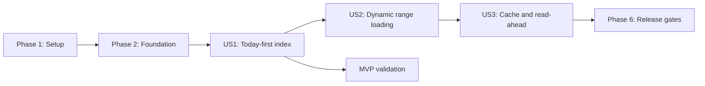

# Tasks: On-Demand Heart Rate Readings

**Input**: Design documents from `specs/002-on-demand-readings/`

**Prerequisites**: [plan.md](plan.md), [spec.md](spec.md), [research.md](research.md), [data-model.md](data-model.md), [contracts/](contracts/), [quickstart.md](quickstart.md)

**Tests**: Tests are mandatory under the project constitution. Within each story, write the listed tests first, confirm they fail for the expected missing behavior, then implement the behavior.

**Organization**: Tasks are grouped by user story so each increment can be validated at its checkpoint.

## Format: `[ID] [P?] [Story] Description`

- **[P]**: Can run in parallel because it changes different files and has no dependency on another incomplete task in the same group.
- **[Story]**: Maps the task to a user story from the feature specification.
- Every task names the exact file or directory it changes.

## Phase 1: Setup (Shared Infrastructure)

**Purpose**: Add the approved storage, hashing, and deterministic test dependencies without changing runtime behavior.

- [x] T001 Install exact-pinned `idb` 8.0.3, `@noble/hashes` 2.4.0, and development-only `fake-indexeddb` dependencies in `package.json` and `package-lock.json`
- [x] T002 [P] Register deterministic IndexedDB setup and cleanup for Vitest without changing the existing timezone isolation in `tests/setup.ts`
- [x] T003 [P] Add synthetic generation, chunk, corruption, quota-failure, and multi-month source builders that never use private health data in `tests/fixtures/index-builder.ts` and `tests/fixtures/google-fit-builder.ts`

**Checkpoint**: Dependencies install, the existing test suite still passes, and deterministic storage fixtures are available.

---

## Phase 2: Foundational (Blocking Prerequisites)

**Purpose**: Establish exact shared types, binary storage rules, and the repository boundary required by every user story.

**CRITICAL**: No user story implementation begins until this phase is complete.

- [x] T004 Define Source Generation, Active Generation Pointer, Generation Manifest, Reading Chunk, Staging Run, Range Request, Range Snapshot, Cache Entry, and Read-Ahead Window types in `src/domain/readings.ts`, enforcing “Only `ready` can become active”, “Session generations are never advertised as durable”, inclusive `startInstantNs <= endInstantNs`, non-negative counts, and `summary` null until coverage is complete
- [x] T005 Define the `index.start`, `index.cancel`, `index.open-active`, `index.clear`, `range.load`, `range.cancel`, and `range.prefetch` command/event unions in `src/shared/worker-messages.ts`, requiring `datasetId`, `generationId`, `viewId`, `requestId`, and increasing `rangeRevision` correlation for range events
- [x] T006 [P] Add failing binary round-trip and rejection tests for exact signed 64-bit epoch nanoseconds, finite BPM from 1 through 300, unsigned 32-bit source IDs/orders, magic `HRGCHNK1`, format version `1`, little-endian aligned offsets, payload length, checksum, source bounds, and monotonic ordering in `tests/unit/chunk-codec.test.ts`
- [x] T007 [P] Add failing manifest tests for descriptors sorted by `(minimumInstantNs, firstSourceOrder)`, closed-interval intersection, binary-search boundary selection, aggregate row/count agreement, empty generations, and unsupported format invalidation in `tests/unit/chunk-manifest.test.ts`
- [x] T008 Implement the versioned packed columnar codec and checksum validation from `contracts/storage-schema.md`, enforcing “`rowCount`: integer from 1 to 16,384” and preserving exact `instantNs`, `bpm`, `sourceId`, and `sourceOrder`, in `src/worker/chunk-codec.ts`
- [x] T009 Implement immutable manifest construction, validation, canonical checksum input, source-table bounds, and closed-range descriptor selection in `src/worker/chunk-manifest.ts`
- [x] T010 Define the worker-owned `ChunkRepository` contract for generation creation, staging-run/chunk access, atomic publication, active-manifest lookup, bounded cleanup, and clear operations in `src/worker/chunk-repository.ts`
- [x] T011 [P] Add failing repository contract tests proving session generations never claim durability, unpublished staging data is never queryable, failed publication retains the prior active generation, and worker termination clears volatile data in `tests/integration/volatile-repository.test.ts`
- [x] T012 Implement the session-only encoded chunk repository with the same generation, checksum, publication, query, and cancellation invariants as durable storage in `src/worker/volatile-repository.ts`

**Checkpoint**: Exact chunks and manifests round-trip deterministically, protocol types compile, and the volatile repository satisfies the common storage contract.

---

## Phase 3: User Story 1 - Open Today's Readings Quickly (Priority: P1) MVP

**Goal**: Fully index one source, atomically retain it, reopen it across sessions, and display only today's exact readings with truthful progress or empty state.

**Independent Test**: Open a prepared multi-month history and verify the selected range is today's local calendar day, only intersecting chunks feed graph/summary/table/details, all views agree, and an empty today remains selected; separately complete and cancel a first-time indexing pass and confirm only a complete generation can become active.

### Tests for User Story 1

> Write these tests first and verify they fail for the intended missing behavior.

- [x] T013 [P] [US1] Add failing IndexedDB repository tests for database `heart-rate-graph` schema version `2`, stores `control`, `generations`, `manifests`, `chunks`, and `stagingRuns`, required indexes, atomic manifest/pointer publication, interrupted writes, corruption, unsupported formats, bounded abandoned-generation cleanup, blocked upgrades, and prior-generation retention in `tests/integration/index-repository.test.ts`
- [x] T014 [P] [US1] Add failing external-sort tests for at most 65,536 accepted readings per staging run, globally ordered k-way merge, at most 16,384 readings per final chunk, exact validation totals, and duplicate classification across run boundaries in `tests/unit/external-sort.test.ts`
- [x] T015 [P] [US1] Extend parser tests with failing assertions that SHA-256 covers the exact source bytes during the same streaming pass, preserves raw timestamp token precision, checks cancellation between parser slices, and never buffers or returns the complete record list when an `onRecord` sink is supplied in `tests/integration/google-fit-parser.test.ts`
- [x] T016 [P] [US1] Add failing local-today tests for `[local midnight, next local midnight - 1 ns]` across ordinary, 23-hour, and 25-hour calendar days, including an injectable clock and timezone in `tests/unit/time-range.test.ts`
- [x] T017 [P] [US1] Add failing reducer/component tests for retained-source startup, indexing phases `reading`, `sorting`, `merging`, `publishing`, and `cleaning`, cancellation, complete today, empty today, corruption recovery, storage failure, and disclosed session-only fallback in `tests/components/import-flow.test.tsx`
- [x] T018 [P] [US1] Add a failing browser journey that indexes a deterministic multi-month source, displays only today, verifies graph/summary/table/detail agreement, reloads the retained generation without file reselection, and observes no health-data network transmission in `tests/e2e/on-demand-readings.spec.ts`

### Implementation for User Story 1

- [x] T019 [US1] Implement typed IndexedDB schema creation, `versionchange` closure, blocked/terminated reporting, bounded writes/cleanup, checksum validation, and the final single `readwrite` transaction that commits manifest, `ready` generation, and `control['active-generation']` in `src/worker/indexeddb-repository.ts`
- [x] T020 [P] [US1] Feed each source byte chunk to `sha256.create().update(chunk)` and the existing parser in one pass, return the lowercase digest only after successful end-of-stream, and preserve cooperative cancellation in `src/worker/parser-adapter.ts`
- [x] T021 [US1] Implement bounded staging-run sorting and k-way merge by exact epoch nanoseconds then source order, applying the existing duplicate tuple rule across run boundaries and emitting final chunks of at most 16,384 rows in `src/worker/external-sort.ts`
- [x] T022 [US1] Replace complete-dataset accumulation with generation creation, validation counting, staged external sorting, chunk persistence, progress phases, cooperative cancellation, atomic publication, and candidate cleanup in `src/worker/import-worker.ts`
- [x] T023 [US1] Implement active-manifest opening and a complete/empty chunk-backed exact query for one inclusive range, binary-searching boundary chunks and deriving graph series, exact table rows, point details, and summaries from the same exact slice in `src/worker/queries.ts`
- [x] T024 [US1] Implement worker startup reopening, index lifecycle commands, persistent/session repository selection, active generation replacement, and user-safe storage/corruption errors without health values in `src/worker/worker-client.ts`
- [x] T025 [P] [US1] Implement injectable-clock local-today construction from consecutive local midnights while retaining source extent separately from the selected inclusive range in `src/domain/time-range.ts`
- [x] T026 [P] [US1] Detect IndexedDB availability and `navigator.storage.persist()` outcomes without treating persistence denial as source corruption in `src/app/browser-capabilities.ts`
- [x] T027 [P] [US1] Update the import UI with full indexing phase/progress/cancel states, persistent versus **Use for this session** choice, unchanged privacy/disclaimer text, and truthful recovery actions in `src/features/import/ImportPanel.tsx`
- [x] T028 [US1] Extend the application state machine so `indexing -> ready`, cancellation/failure retention, `retention: "persistent" | "session"`, and today's `loading`, `complete`, and `empty` snapshots are explicit and prior active state survives failed replacement in `src/app/app-reducer.ts` and `src/app/app-context-values.ts`
- [x] T029 [US1] Orchestrate retained-generation startup, first/replacement indexing, today's initial range request, and one coherent snapshot for chart, exact table, point details, and summary in `src/app/App.tsx`
- [x] T030 [US1] Add stable responsive styling and visible/non-visual status treatment for indexing, loading, complete, empty, storage failure, and session-only retention without changing the established visual language in `src/styles.css`

**Checkpoint**: User Story 1 passes independently and is the deployable MVP: first import is complete and cancellable, publication is atomic, reopen is durable, and only today's readings enter the active view.

---

## Phase 4: User Story 2 - Zoom Through History On Demand (Priority: P2)

**Goal**: Load every committed visible range dynamically with coverage-aware feedback while stale or cancelled requests can never replace the latest selection.

**Independent Test**: Starting from today, commit the same one-hour range through pointer/touch, keyboard, and exact fields, zoom out across cached and uncached chunks, then commit 20 ranges rapidly; verify progress appears, partial data is never called complete, all views converge on the exact final range, and only the latest revision wins.

### Tests for User Story 2

> Write these tests first and verify they fail for the intended missing behavior.

- [x] T031 [P] [US2] Add failing chunk-backed range tests for inclusive boundaries, intersecting-chunk-only reads, partial coverage clipped to the request, ordered exact rows, complete/empty coverage, summary null for `partial` and `empty`, exact final summaries, and unchanged display aggregation rules in `tests/integration/on-demand-range.test.ts`
- [x] T032 [P] [US2] Add failing worker protocol tests for `range.started`, `range.progress`, `range.snapshot`, `range.cancelled`, and `range.failed`, one foreground operation, cancellation checkpoints, and stale filtering across every `datasetId`, `generationId`, `viewId`, `requestId`, and `rangeRevision` field in `tests/integration/index-worker.test.ts`
- [x] T033 [P] [US2] Add failing reducer tests for `queued -> loading -> partial -> complete|empty`, `queued|loading|partial -> cancelled|failed`, atomic same-request snapshot replacement, prior-result stale labeling, and rejection of cross-generation/revision snapshots in `tests/unit/app-reducer.test.ts`
- [x] T034 [P] [US2] Add failing component tests proving pointer, touch, keyboard, Today, adjacent-day, reset, and exact date/time actions share one canonical commit path while controls remain enabled and focused during loading in `tests/components/range-controls.test.tsx`
- [x] T035 [P] [US2] Extend the browser journey with uncached one-day loading, cached-plus-missing partial coverage, broad zoom, empty range, error recovery, and 20 rapid commits where no older completed result appears after the latest selection in `tests/e2e/on-demand-readings.spec.ts`

### Implementation for User Story 2

- [x] T036 [US2] Refactor chunk-backed queries to stream selected descriptors, reuse exact covered readings, emit valid partial snapshots, withhold final summaries until complete coverage, paginate the same exact slice, and transfer only requested-range result buffers in `src/worker/queries.ts`
- [x] T037 [US2] Implement foreground `range.load`/`range.cancel` scheduling with cancellation checks between IndexedDB reads, decodes, merge batches, and aggregate batches, allowing at most one foreground storage/decode operation in `src/worker/import-worker.ts`
- [x] T038 [US2] Implement complete correlation matching, latest-revision authority, cancellation on supersession/unmount, and stale index/range event rejection in `src/worker/worker-client.ts`
- [x] T039 [US2] Add explicit `loading`, `partial`, `complete`, `empty`, `cancelled`, and `failed` range state and guarded correlation transitions to `src/app/app-reducer.ts`
- [x] T040 [P] [US2] Implement deterministic anchor-centered zoom-in, reciprocal midpoint zoom-out, adjacent local-calendar-day navigation, Today recomputation, and canonical committed inclusive ranges in `src/domain/time-range.ts`
- [x] T041 [US2] Route pointer selection, touch gestures, keyboard zoom, exact fields, Today, adjacent-day navigation, and reset through one commit callback while keeping stable control dimensions in `src/features/chart/HeartRateChart.tsx` and `src/features/range/TimeRangeControls.tsx`
- [x] T042 [P] [US2] Create visual and live-region feedback that names the requested range, distinguishes every range state without color alone, announces only phase/meaningful progress changes, and honors reduced motion in `src/features/range/RangeLoadingStatus.tsx`
- [x] T043 [US2] Integrate canonical commits, immediate loading state, cancellation, coverage-aware snapshots, synchronized graph/summary/table/details, and failed-range recovery in `src/app/App.tsx`, `src/features/accessible-data/RangeSummary.tsx`, `src/features/accessible-data/ReadingTable.tsx`, and `src/styles.css`

**Checkpoint**: User Stories 1 and 2 pass independently and together; every input method produces the same range contract, partial state stays truthful, and the latest committed revision is authoritative.

---

## Phase 5: User Story 3 - Revisit Nearby Ranges Efficiently (Priority: P3)

**Goal**: Reuse decoded chunks, prepare adjacent local days without delaying foreground work, preserve a valid generation across replacement failures, and let the user clear retained health data.

**Independent Test**: Complete one day, allow background preparation, navigate before/after/back, and verify cache reuse without duplicate parsing or visible-range changes; then test memory pressure, source replacement, reload, corruption, session-only mode, and clearing all retained data.

### Tests for User Story 3

> Write these tests first and verify they fail for the intended missing behavior.

- [x] T044 [P] [US3] Add failing byte-weighted LRU tests for generation/chunk compound keys, a 16 MiB default budget, recency updates, pinned foreground entries, unpinned eviction, oversized active entries released after use, and generation invalidation in `tests/unit/chunk-lru.test.ts`
- [x] T045 [P] [US3] Add failing prefetch integration tests for at most one local calendar day before and after a complete foreground range, prepared-chunk reuse, no duplicate source processing, quiet completion, memory-pressure skip, foreground preemption, and background failure isolation in `tests/integration/on-demand-range.test.ts`
- [x] T046 [P] [US3] Extend repository/replacement tests for source-digest invalidation, failed/cancelled replacement retaining the prior generation/range/cache, successful atomic switch, stale-generation eviction, startup cleanup, clear success, blocked clear, and session-only termination in `tests/integration/replacement-import.test.ts`
- [x] T047 [P] [US3] Add failing component tests for persistent/session retention labels, replacement progress, non-disruptive read-ahead, source invalidation, clear-data confirmation, disabled actions during deletion, and retry guidance after blocked/failed deletion in `tests/components/data-retention.test.tsx`
- [x] T048 [P] [US3] Extend the browser journey to verify preceding/following-day reuse, later-session reopen, failed and successful replacement behavior, stale-generation rejection, session-only loss on reload, and clear-data return to no-source state in `tests/e2e/on-demand-readings.spec.ts`

### Implementation for User Story 3

- [x] T049 [P] [US3] Implement the byte-weighted decoded chunk LRU with a 16 MiB default budget, pin counts, access sequencing, deterministic eviction diagnostics, oversized foreground handling, and generation-scoped clear in `src/worker/chunk-lru.ts`
- [x] T050 [US3] Integrate checksum-before-cache, generation/chunk cache keys, exact cached slice reuse, missing-interval reads, and cache hit/miss/eviction diagnostics containing no heart-rate values in `src/worker/queries.ts`
- [x] T051 [US3] Implement lower-priority `range.prefetch` for up to one preceding and one following local calendar day after foreground completion, yielding at chunk boundaries and pausing/cancelling when foreground work arrives in `src/worker/import-worker.ts`
- [x] T052 [US3] Implement source-digest invalidation, startup garbage collection, old-generation cleanup after successful publication, blocked/failed database deletion, and complete persistent/volatile clear semantics in `src/worker/indexeddb-repository.ts` and `src/worker/volatile-repository.ts`
- [x] T053 [US3] Implement replacement-generation correlation, prefetch dispatch/cancellation, cache invalidation, clear acknowledgement, connection shutdown, and stale-generation event rejection in `src/worker/worker-client.ts`
- [x] T054 [P] [US3] Add storage persistence requests and user-safe availability/quota/eviction capability results without health data to `src/app/browser-capabilities.ts`
- [x] T055 [P] [US3] Add replacement, persistent/session status, re-index, retry, and confirmed **Clear retained data** controls with correct disabled/focus behavior in `src/features/import/ImportPanel.tsx`
- [x] T056 [US3] Integrate quiet adjacent-day read-ahead, retained-generation reuse, replacement safety, storage recovery, and clear-to-no-source state in `src/app/App.tsx`, `src/app/app-reducer.ts`, and `src/styles.css`

**Checkpoint**: All three stories pass independently and together; nearby revisits reuse prepared chunks, foreground interaction always wins, replacements are atomic, and users control retained local health data.

---

## Phase 6: Polish and Cross-Cutting Release Gates

**Purpose**: Prove performance, privacy, accessibility, responsive behavior, and correctness across the complete feature.

- [x] T057 [P] Add cold/warm prepared-history, uncached day, cached interaction, 20-range supersession, cache reuse, and bounded-memory scenarios for 1,000,000 accepted readings with at least 20 post-warm-up samples and p50/p95 reporting in `tests/performance/on-demand-performance.spec.ts` and `tests/performance/generate-million-records.ts`
- [x] T058 [P] Extend axe and keyboard coverage for indexing, loading, partial, complete, empty, cancelled, failed, session-only, replacement, and clear states across Chromium, Firefox, and WebKit in `tests/e2e/accessibility.spec.ts`
- [x] T059 [P] Extend responsive/200%-zoom and network interception assertions so controls and status never overlap and no source bytes, metadata, digest, readings, chunks, summaries, or derived health data leave the app in `tests/e2e/responsive.spec.ts` and `tests/e2e/privacy.spec.ts`
- [x] T060 Run `npm run format:check`, `npm run lint`, `npm run typecheck`, `npm test`, `npm run build`, `npm run test:e2e`, and `npm run test:performance`; record SC-001 through SC-010 results, representative device/browser details, and the 4-of-5 usability outcome in `specs/002-on-demand-readings/validation-report.md`

**Checkpoint**: Every constitution gate and measurable success criterion has reproducible evidence.

---

## Dependencies and Execution Order

### Phase Dependencies

- **Phase 1 - Setup**: Starts immediately.
- **Phase 2 - Foundational**: Depends on Phase 1 and blocks all user stories.
- **Phase 3 - User Story 1**: Depends on Phase 2 and delivers the today-first persistent-index MVP.
- **Phase 4 - User Story 2**: Depends on the US1 index/query path; tests can be authored after Phase 2 against repository fakes.
- **Phase 5 - User Story 3**: Depends on US1 durable generations and US2 foreground scheduling; LRU and UI tests can be authored earlier against contracts.
- **Phase 6 - Polish**: Depends on every story selected for release.

### User Story Dependency Graph



### Within Each User Story

1. Write the story tests and verify they fail for the expected missing behavior.
2. Implement pure domain and storage primitives before worker orchestration.
3. Implement worker scheduling and client correlation before UI integration.
4. Integrate all views through the single range snapshot.
5. Run the independent story test and all prior-story regression tests at the checkpoint.

## Parallel Opportunities

- In Setup, T002 and T003 can run concurrently after T001 installs dependencies.
- In Foundation, T006, T007, and T011 can be authored concurrently; T008 and T009 then implement separate modules before T010/T012 complete repository wiring.
- In US1, T013 through T018 can be authored concurrently; T020, T025, T026, and T027 modify independent modules while IndexedDB and external-sort work proceeds serially.
- In US2, T031 through T035 can be authored concurrently; T040 and T042 implement independent pure-domain and status-component work while worker query/scheduler changes are serialized.
- In US3, T044 through T048 can be authored concurrently; T049, T054, and T055 modify independent modules before cache, prefetch, lifecycle, and app integration.
- T057 through T059 can run in parallel after all selected stories are complete.
- Shared integration points `src/worker/import-worker.ts`, `src/worker/queries.ts`, `src/worker/worker-client.ts`, `src/app/app-reducer.ts`, `src/app/App.tsx`, and `src/styles.css` must be serialized.

## Parallel Example: User Story 1

```text
Task T013: IndexedDB atomic-publication tests in tests/integration/index-repository.test.ts
Task T014: External-sort boundary tests in tests/unit/external-sort.test.ts
Task T015: Streaming digest/parser tests in tests/integration/google-fit-parser.test.ts
Task T016: Local-today/DST tests in tests/unit/time-range.test.ts
Task T017: Indexing/today component tests in tests/components/import-flow.test.tsx
Task T018: Today-first browser journey in tests/e2e/on-demand-readings.spec.ts
```

## Parallel Example: User Story 2

```text
Task T031: Chunk-backed range tests in tests/integration/on-demand-range.test.ts
Task T032: Worker correlation/cancellation tests in tests/integration/index-worker.test.ts
Task T033: Range lifecycle reducer tests in tests/unit/app-reducer.test.ts
Task T034: Canonical range-control tests in tests/components/range-controls.test.tsx
Task T035: Dynamic range browser journey in tests/e2e/on-demand-readings.spec.ts
```

## Parallel Example: User Story 3

```text
Task T044: LRU tests in tests/unit/chunk-lru.test.ts
Task T045: Read-ahead scheduling tests in tests/integration/on-demand-range.test.ts
Task T046: Replacement/retention tests in tests/integration/replacement-import.test.ts
Task T047: Retention UI tests in tests/components/data-retention.test.tsx
Task T048: Revisit/clear browser journey in tests/e2e/on-demand-readings.spec.ts
```

## Implementation Strategy

### MVP First

1. Complete Phase 1 and Phase 2.
2. Complete User Story 1 tests, implementation, and checkpoint.
3. Stop and validate atomic first import, retained reopen, today/DST selection, exact-view agreement, empty today, session-only recovery, accessibility, and privacy.
4. Demo or deploy the today-first MVP before adding dynamic zoom and optimization.

### Incremental Delivery

1. Add User Story 2 and validate dynamic loading, partial coverage, all input methods, and latest-revision authority.
2. Add User Story 3 and validate decoded reuse, adjacent-day preparation, replacement safety, retention, corruption recovery, and clear-data control.
3. Complete Phase 6 with synthetic million-reading data and representative desktop/mobile browser evidence.

### Parallel Team Strategy

After Foundation, one contributor can build the IndexedDB/import path while others prepare US1 tests and today/UI modules. After US1, one contributor can implement range query/scheduling while another prepares cache/read-ahead tests. Changes to the serialized integration points listed above must be landed in task order.

## Requirements Coverage

- **US1 / FR-001-003, FR-012, FR-014-021**: T013-T030 cover complete indexing, exact storage, atomic publication, today-first retrieval, persistence, session fallback, privacy, and recovery.
- **US2 / FR-002-008, FR-013**: T031-T043 cover inclusive on-demand retrieval, truthful lifecycle/coverage, canonical zoom inputs, cancellation, and synchronized exact views.
- **US3 / FR-008-011, FR-015-019, FR-022**: T044-T056 cover LRU reuse, adjacent-day prefetch, source-scoped invalidation, replacement, persistence, corruption, and clearing.
- **SC-001-SC-010**: T057-T060 provide performance, accessibility, privacy, responsive, stale-result, reuse, and usability evidence.

## Notes

- Keep each listed test red for the intended reason before implementing its behavior, then run the narrowest affected test after every substantive edit.
- Do not log, commit, upload, or persist private fixture contents or reading-level data outside the local application stores.
- Prepare bytes and hashes before opening IndexedDB transactions; inside a transaction, issue only storage requests and await `transaction.done`.
- A partial snapshot may expose exact covered readings but must never expose a completed summary or final total.
- The active Spec Kit feature identifier is `002-on-demand-readings`.
